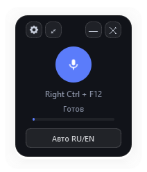

# TalkText


Портативная программа для Windows, которая превращает речь в текст: русский и
английский, локально, без интернета и оплаты. Небольшое плавающее окно поверх
всех окон, горячая клавиша, автоматическая вставка текста в активное приложение.

Один архив, без установки и без записей в реестр: настройки и загруженные движки
лежат рядом с программой в `settings.ini` и `models\`.

[**Скачать**](https://github.com/NoobDev68/TalkText/releases/latest) ·
[**Отблагодарить автора**](https://pay.cloudtips.ru/p/a87b504b) ·
[**Я на Boosty**](https://boosty.to/threer)


## Возможности

- **Речь в текст локально** — без облака и оплаты. Русский и английский
  распознаются на вашем компьютере.
- **Автоопределение языка** — каждая фраза определяется и уходит в лучший для
  языка движок: русская — в GigaAM v3, английская — в Whisper turbo (если turbo
  скачан, иначе в другой установленный Whisper).
- **Ручной выбор движка** — кнопка в окне: «Авто — по языку» или конкретный
  движок (GigaAM v3, Whisper-Podlodka-Turbo, Whisper turbo, small, base,
  Multilingual). В полном окне кнопки языка и движка раздельные, в компактном —
  одно меню на две группы.
- **Два режима окна** — компактный (только кнопка и переключатель) и полный
  (с текстом, «Копировать» и «Очистить»). Полное окно тянется за края, при смене
  режима остаётся в правом нижнем углу.
- **Автовставка** — включена по умолчанию: текст сам вставляется туда, где стоит
  курсор. Окно при этом не забирает фокус. Галочка «Вставлять» отключает её.
- **Автоочистка** — галочка рядом с «Очистить»: история стирается перед каждой
  новой записью, в окне остаётся только текущая диктовка.
- **Горячая клавиша** — по умолчанию `Right Ctrl + F12`, меняется в настройках.
  Подсказка с текущей комбинацией видна в компактном окне.
- **Трей** — окно сворачивается в трей, значок меняется в зависимости от записи;
  свёрнутое окно не выскакивает при старте распознавания.
- **Автозапуск** — по желанию стартует вместе с Windows, окно появляется в правом
  нижнем углу над часами.
- **Выбор движков** — при первом запуске предлагается выбрать, что скачать:
  лёгкие движки Сбера под русский или Whisper для английского.
- **Подбор под компьютер** — кнопка «Рекомендовано» в настройках смотрит на
  видеокарту и её память, объём ОЗУ и свободное место и сама ставит галочки на
  движках, которые имеют смысл именно на этой машине.
- **Два языка интерфейса** — русский и английский, переключаются кнопкой
  **RU/EN** в заголовке окна, без перезапуска программы.




## Скачать и запустить

1. Скачать **TalkText.Portable.zip** из последнего релиза — 142 МБ.
2. Распаковать архив в любую папку, кроме `Program Files`.
3. Запустить `TalkText.exe`.
4. При первом запуске выбрать движки — они скачаются с HuggingFace (от 102 МБ
   до 1,7 ГБ в зависимости от выбора).

Устанавливать ничего не нужно: Python и зависимости уже внутри. Интернет нужен
только для скачивания движков — после этого программа работает офлайн.

Сборка не подписана, поэтому SmartScreen может предупредить — «Подробнее» →
«Выполнить в любом случае».

**Контрольная сумма** (SHA256):

```
494c77344800f2de39fa181ae18a01aeea4de2a082a0e02ea00c19fec3738f0f
```

Проверка в PowerShell:

```powershell
certutil -hashfile "TalkText.Portable.zip" SHA256
```

## Требования

- Windows 10 или 11, 64-бит.
- Около 360 МБ на диске (программа без движков).
- Движки: GigaAM v3 — 216 МБ, Whisper base — 102 МБ (работают на процессоре);
  Whisper large-v3-turbo и Whisper-Podlodka-Turbo — по ~1.5 ГБ и видеокарта
  NVIDIA; Whisper small — ~460 МБ (можно без видеокарты).
- Микрофон.

## Движки

| Движок | Размер | Что умеет | Пунктуация |
|---|---|---|---|
| Whisper-Podlodka-Turbo | ~1.5 ГБ (с NVIDIA) | русский — лучший на чистой речи, английский тоже | да |
| GigaAM v3 (Сбер) | 216 МБ | русский на процессоре, устойчив к шуму | да |
| Whisper large-v3-turbo | ~1.5 ГБ (с NVIDIA) | английский — лучший по точности, вдвое быстрее Podlodka | да |
| Whisper small | ~460 МБ | английский — компромисс, работает и на процессоре | да |
| Whisper base (ONNX, CPU) | 102 МБ | английский, самый лёгкий | да |
| GigaAM Multilingual | 214 МБ | казахский, киргизский, узбекский | нет |

Скачиваются из окна настроек, там же удаляются. В окне движки подписаны коротко:
GigaAM, Podlodka, turbo, small, base, Multilingual — полные названия видны в
подсказке и в настройках.

## Проверка качества

Русский — 20 фраз из открытого датасета Golos (WER — доля ошибок в словах):

| Движок | WER | CER | Скорость | Пунктуация |
|---|---|---|---|---|
| GigaAM Multilingual (CPU) | **5.5%** | **1.5%** | 0.40 с | нет |
| Whisper-Podlodka-Turbo (GPU) | 10.8% | 5.2% | 0.31 с | 90% |
| GigaAM v3 (CPU) | 11.7% | 5.9% | 0.47 с | **100%** |
| Whisper large-v3-turbo (GPU) | 15.0% | 6.3% | 0.31 с | 70% |

GigaAM Multilingual даёт лучший WER, но вообще не ставит пунктуацию и заглавные
буквы — для диктовки это неудобно. Whisper-Podlodka-Turbo (русский файнтюн от
Ивана Бондаренко, Apache-2.0) точнее GigaAM v3 на чистой речи и вдвое быстрее на
видеокарте, но на шуме проседает.

Устойчивость к шуму на тех же 20 фразах Golos с добавленным белым шумом:

| Движок | тихо | шум 20 дБ | шум 10 дБ |
|---|---|---|---|
| GigaAM v3 | 11.7% | **11.3%** | **16.3%** |
| Whisper-Podlodka-Turbo | **10.8%** | 17.6% | 18.9% |

Отсюда правило: **русский по умолчанию — GigaAM v3** (не боится шума, всегда с
пунктуацией, работает без видеокарты), а Podlodka — осознанный выбор для тихой
комнаты и видеокарты: там он и точнее, и быстрее.

Английский — 40 фраз LibriSpeech test-clean и 40 фраз test-other:

| Движок | clean | other | Пунктуация | Заглавные |
|---|---|---|---|---|
| Whisper large-v3-turbo | **2.9%** | **4.9%** | 80% | 78% |
| Whisper-Podlodka-Turbo | 3.0% | 6.2% | **100%** | **100%** |

На чистой речи они равны, на сложной (диалекты, шум) turbo точнее, зато Podlodka
всегда ставит пунктуацию и заглавные. Поэтому в режиме «Авто» английский идёт в
turbo, а Podlodka — вторая очередь.

Whisper base против small — те же фразы, base только на процессоре:

| Вариант | RU WER | EN WER | Скорость на CPU | Пунктуация RU / EN |
|---|---|---|---|---|
| Whisper base | 44.6% | 3.7% | 0.9 с/фразу | 50% / 100% |
| Whisper small | 26.9% | 3.0% | ~6 с/фразу | 75% / 100% |

Итог: base — самый лёгкий (102 МБ) и быстрый на процессоре, английский сносный,
русский негодный. small даёт заметно меньше ошибок, но на процессоре в шесть раз
медленнее; на видеокарте он быстрый и лучший из лёгких. Поэтому при установленном
small программа предпочитает его, а base остаётся выбором для совсем слабых
машин — его можно включить вручную в меню движков.

На английском Whisper large-v3-turbo заметно точнее base на акценте, именах и
терминах («Kubernetes» вместо «Cuba Internet's» и т.п.) и при этом быстрее на
видеокарте.

## Ограничения

- **Смешанная речь** определяется по фразе: если есть русские слова, фраза идёт в
  GigaAM v3 — короткие англицизмы он пишет латиницей, длинные английские куски
  могут искажаться. Надёжнее разделять языки паузой.
- Whisper turbo, Podlodka и small требуют видеокарту NVIDIA для быстрой работы;
  без неё они считают на процессоре, но медленно.
- Распознавание локальное — на качество влияет микрофон и шум.

## Поддержать проект

Программа бесплатная и портативная, без рекламы и подписок. Если она помогла —
можно отблагодарить автора: [**Отблагодарить автора**](https://pay.cloudtips.ru/p/a87b504b).

[**Я на Boosty**](https://boosty.to/threer).

В самой программе для этого есть кнопка **«Отблагодарить автора»** в окне настроек.

## Сборка из исходников

Нужен Python 3.12 и зависимости:

```
pip install -r requirements.txt pyinstaller
python -m PyInstaller --noconfirm TalkText.spec
```

Готовое приложение появится в `dist\TalkText\`. Движки скачиваются при первом
запуске.

## Лицензия

MIT — см. [LICENSE](LICENSE). Создатели: ThreeR и DeepSeek.

Лицензии сторонних компонентов и движков — в файле
[THIRD_PARTY.md](THIRD_PARTY.md); он же лежит рядом с `TalkText.exe` в архиве.
