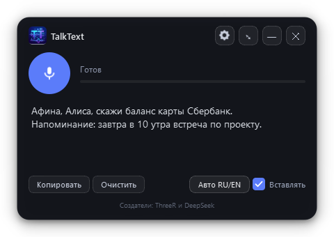

# TalkText


Портативная программа для Windows, которая превращает речь в текст: русский и
английский, локально, без интернета и оплаты. Небольшое плавающее окно поверх
всех окон, горячая клавиша, автоматическая вставка текста в активное приложение.

Один архив, без установки и без записей в реестр: настройки и загруженные движки
лежат рядом с программой в `settings.ini` и `models\`.

[**Скачать**](https://github.com/NoobDev68/TalkText/releases/latest) ·
[**Отблагодарить автора**](https://pay.cloudtips.ru/p/a87b504b)


## Возможности

- **Речь в текст локально** — без облака и оплаты. Русский и английский
  распознаются на вашем компьютере.
- **Автоопределение языка** — каждая фраза определяется и уходит в лучший для
  языка движок: русская — в GigaAM v3, английская — в Whisper.
- **Два режима окна** — компактный (только кнопка и переключатель) и полный
  (с текстом, «Копировать» и «Очистить»). Полное окно тянется за края.
- **Автовставка** — при включённой галочке текст сам вставляется туда, где стоит
  курсор. Окно при этом не забирает фокус.
- **Горячая клавиша** — по умолчанию `Right Ctrl + F12`, меняется в настройках.
  Подсказка с текущей комбинацией видна в компактном окне.
- **Трей** — окно сворачивается в трей, значок меняется в зависимости от записи;
  свёрнутое окно не выскакивает при старте распознавания.
- **Автозапуск** — по желанию стартует вместе с Windows, окно появляется в правом
  нижнем углу над часами.
- **Выбор движков** — при первом запуске предлагается выбрать, что скачать:
  лёгкие движки Сбера (330 МБ) или точный Whisper large для видеокарт NVIDIA.




## Скачать и запустить

1. Скачать **TalkText.Portable.zip** из последнего релиза — 138 МБ.
2. Распаковать архив в любую папку, кроме `Program Files`.
3. Запустить `TalkText.exe`.
4. При первом запуске выбрать движки — они скачаются с HuggingFace (от 330 МБ).

Устанавливать ничего не нужно: Python и зависимости уже внутри. Интернет нужен
только для скачивания движков — после этого программа работает офлайн.

Сборка не подписана, поэтому SmartScreen может предупредить — «Подробнее» →
«Выполнить в любом случае».

**Контрольная сумма** (SHA256):

```
25cd9057e1f2f7b8c2fd9842da6749729318cbf63fde188bdfccb1eedd921113
```

Проверка в PowerShell:

```powershell
certutil -hashfile "TalkText.Portable.zip" SHA256
```

## Требования

- Windows 10 или 11, 64-бит.
- Около 430 МБ на диске (программа без движков).
- Движки: GigaAM v3 — 216 МБ, Whisper base — 102 МБ (работают на процессоре);
  Whisper large-v3 — ещё ~4.7 ГБ и видеокарта NVIDIA.
- Микрофон.

## Движки

| Движок | Размер | Что умеет | Пунктуация |
|---|---|---|---|
| GigaAM v3 (Сбер) | 216 МБ | русский — лучшее качество | да |
| Whisper large-v3 | ~4.7 ГБ (с NVIDIA) | английский — лучший по точности | да |
| Whisper base (ONNX, CPU) | 102 МБ | английский без видеокарты | да |
| GigaAM Multilingual | 214 МБ | казахский, киргизский, узбекский | нет |

Скачиваются из окна настроек, там же удаляются.

## Проверка качества

Русский — 20 фраз из открытого датасета Golos (WER — доля ошибок в словах):

| Движок | WER | CER | Скорость |
|---|---|---|---|
| GigaAM Multilingual | 5.5% | 1.5% | 0.40 с на фразу |
| GigaAM v3 | 11.7% | 5.9% | 0.38 с на фразу |
| Whisper large-v3 (GPU) | 13.8% | 7.4% | 0.62 с на фразу |

На английском Whisper large заметно точнее base на акценте, именах и терминах
(«Kubernetes» вместо «Cuba Internet's» и т.п.) и при этом быстрее на видеокарте.

## Ограничения

- **Смешанная речь** определяется по фразе: если есть русские слова, фраза идёт в
  GigaAM v3 — короткие англицизмы он пишет латиницей, длинные английские куски
  могут искажаться. Надёжнее разделять языки паузой.
- Whisper large требует видеокарту NVIDIA; без неё работает на процессоре, но
  медленно.
- Распознавание локальное — на качество влияет микрофон и шум.

## Поддержать проект

Программа бесплатная и портативная, без рекламы и подписок. Если она помогла —
можно отблагодарить автора: [**Отблагодарить автора**](https://pay.cloudtips.ru/p/a87b504b).

В самой программе для этого есть кнопка **«Отблагодарить автора»** в окне настроек.

## Сборка из исходников

Нужен Python 3.12 и зависимости:

```
pip install -r requirements.txt pyinstaller
python -m PyInstaller --noconfirm TalkText.spec
```

Готовое приложение появится в `dist\TalkText\`. Движки скачиваются при первом
запуске.

## Лицензия

MIT — см. [LICENSE](LICENSE). Создатели: ThreeR и DeepSeek.
